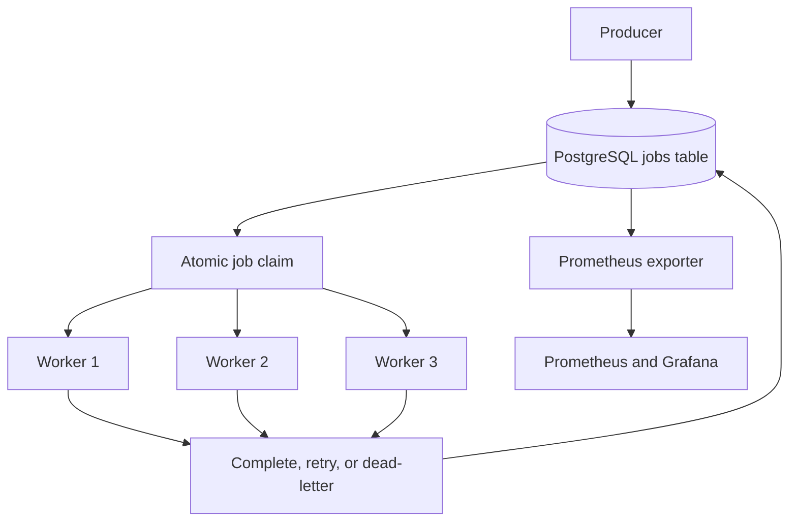

# PostgreSQL-Backed Distributed Job Queue

A distributed job-processing system that uses PostgreSQL to coordinate multiple asynchronous workers.

The project explores how background job systems handle concurrent claiming, retries, worker failures, lease renewal, dead-lettered jobs, and operational monitoring. It is intended for moderate workloads where PostgreSQL is already part of the application stack.

**Measured results** (no-op handlers, single machine; see [Benchmarks](#benchmarks)):

- About 17,800 jobs/s sustained over 100,000 jobs with 16 workers, 16x faster than the original one-job-per-claim design (about 1,100 jobs/s)
- About 37,000–40,000 jobs/s bulk enqueue with idempotency-key deduplication
- Claim latency: p50 1.05–1.06 ms, p99 1.32–1.45 ms
- Zero duplicate completions across all benchmark runs (see [definition](#how-duplicates-are-detected))
- A job held by a SIGKILLed worker process was recovered and completed 5.1 s after the kill, with a 6 s lease

## Motivation

Applications often need to run work that should not block an API request, such as processing files, generating reports, or sending notifications. Existing tools such as Celery already support these workflows, but I wanted to understand the coordination mechanisms behind them.

I built this project to explore the following questions:

- How can several workers claim jobs without processing the same available row simultaneously?
- How can unfinished jobs be recovered after a worker stops?
- How should retries and permanently failed jobs be handled?
- What information is needed to monitor the health of a job queue?
- When is PostgreSQL sufficient, and when is a dedicated message broker a better choice?

## Features

- Concurrent job claiming with `SELECT FOR UPDATE SKIP LOCKED`
- Batched claim and completion (one SQL round trip per batch)
- Bulk enqueue with idempotency-key deduplication
- Multiple asynchronous workers
- Lease-based recovery of interrupted jobs
- Periodic lease renewal for long-running jobs
- Configurable retry attempts and retry delays
- Dead-letter handling after retry exhaustion
- Priority-based job selection
- Idempotency keys for duplicate job submissions
- Worker heartbeats and job event history
- Prometheus metrics and a Grafana dashboard
- Docker Compose setup
- Failure-oriented tests for core queue behavior

## Architecture



PostgreSQL stores both the job data and its processing state. Workers use row-level locking with `SKIP LOCKED` so they can select different available jobs without waiting for rows that another worker is already claiming.

## Job Lifecycle

1. A producer inserts a pending job.
2. A worker atomically claims a batch of up to `BATCH_SIZE` available jobs, marks them running, sets their lease expiration, and logs their events in a single SQL statement.
3. The worker runs the handlers in the batch concurrently.
4. While the batch runs, the worker periodically renews the leases for all of its jobs.
5. Successful jobs are marked as completed together in one statement.
6. Failed jobs return to the queue after a configured delay.
7. Jobs that exhaust their allowed attempts are moved to the dead-letter state.
8. If a worker stops and its lease expires, another worker can recover the job.

## Delivery Semantics

The queue provides **at-least-once execution** with exclusive claiming of currently available jobs.

`SELECT FOR UPDATE SKIP LOCKED` prevents workers from claiming the same available row at the same time. However, a job may run more than once if a worker performs a side effect and stops before recording successful completion.

Handlers that produce external side effects should therefore be idempotent or use a separate deduplication mechanism.

Idempotency keys in this project prevent duplicate job submissions. They do not guarantee that an external side effect occurs only once.

## Technology

- Python 3.11+
- PostgreSQL 14+
- `asyncpg`
- Docker and Docker Compose
- Prometheus
- Grafana
- Rich terminal UI

## Quick Start

### Docker Compose

The Docker Compose configuration starts PostgreSQL, three workers, Prometheus, Grafana, and the metrics exporter.

```bash
docker compose up --build
```

After the services start:

| Service | Address |
| --- | --- |
| Grafana | `http://localhost:3000` |
| Prometheus | `http://localhost:9090` |
| Prometheus metrics | `http://localhost:8000/metrics` |

The included local Grafana configuration uses `admin` as both the username and password. Change these credentials before using the setup outside a local development environment.

### Local Setup

Create a PostgreSQL database and apply the schema:

```bash
createdb jobqueue2
psql -U "$USER" -d jobqueue2 -f schema.sql
```

Install the Python dependencies:

```bash
python -m pip install -r requirements.txt
```

Start the application:

```bash
python main.py
```

## Adding a Job Type

Define an asynchronous handler:

```python
async def handle_my_job(payload: dict) -> dict:
    result = do_something(payload["input"])
    return {"output": result}
```

Register the handler on each worker:

```python
worker.register_handler("my_job_type", handle_my_job)
```

Submit a job:

```python
job_id = await qm.enqueue(
    Job(
        job_type="my_job_type",
        payload={"input": "hello"},
        queue_name="default",
        priority=3,
        max_attempts=5,
        idempotency_key="unique-key-123",
    )
)
```

Handlers that communicate with external services should be safe to retry.

## Configuration

Configuration values are defined in `config.py` and can be overridden with environment variables.

| Setting | Default | Purpose |
| --- | ---: | --- |
| `BATCH_SIZE` | `10` | Jobs claimed per poll; jobs in a batch run concurrently |
| `poll_interval_sec` | `1.0` | Delay between polls when no job is available |
| `lease_duration_sec` | `30` | Initial period for which a worker owns a job |
| `lease_renewal_interval_sec` | `10` | Frequency of lease renewal during execution |
| `default_max_attempts` | `3` | Attempts allowed before dead-lettering |
| `default_retry_delay_sec` | `5` | Delay before retrying a failed job |
| `recovery_interval_sec` | `15` | Frequency of expired-lease recovery |
| `heartbeat_interval_sec` | `5` | Frequency of worker heartbeat updates |
| `NUM_WORKERS` | `3` | Number of workers used by the Docker setup |

The lease duration should be longer than the renewal interval. Appropriate values depend on handler duration, expected network delays, and acceptable recovery time.

## Observability

The metrics exporter provides information about:

- Pending job count
- Completed-job throughput
- Execution latency percentiles
- Failure rate
- Active workers
- Individual worker health
- Dead-letter growth

The repository includes Prometheus configuration, Grafana provisioning, and example alerting rules. The supplied thresholds are starting points for local testing and should be adjusted for a real workload.

## Testing

The failure-oriented test suite covers:

- Duplicate submissions using the same idempotency key
- Exclusive claiming with concurrent workers
- Retry exhaustion and dead-letter handling
- Priority-based job selection
- Lease renewal for a 25-second job
- Crash recovery: a worker running in a separate OS process is killed with SIGKILL mid-job, and the test checks that another worker recovers and completes the job after the lease expires

Run the tests with:

```bash
python chaos_test.py
```

The script exits with a non-zero status if any scenario fails. GitHub Actions (`.github/workflows/ci.yml`) runs the full suite against a PostgreSQL 16 service container on every push to `main` and on every pull request.

These tests validate the scenarios implemented in this repository. They are not a formal proof of exactly-once execution or production reliability.

## Benchmarks

Measured with `benchmark.py` on an Apple M5 Pro, PostgreSQL 16 in Docker (6 vCPUs, default durability settings: `fsync` and `synchronous_commit` left on), Python 3.11, asyncpg 0.29. Handlers are no-ops, so these numbers show the queue's overhead and do not include any real work. Each run starts with a pre-filled queue and is timed until the last job completes. The tables show two full runs.

### Throughput

| Workers | Batch size | Jobs | Run 1 (jobs/s) | Run 2 (jobs/s) | Duplicate completions |
| ---: | ---: | ---: | ---: | ---: | ---: |
| 1 | 1 | 2,000 | 471 | 464 | 0 |
| 16 | 1 | 10,000 | 2,069 | 2,021 | 0 |
| 16 | 10 | 20,000 | 13,159 | 13,185 | 0 |
| 16 | 50 | 50,000 | 26,610 | 24,174 | 0 |
| 16 (4 processes × 4) | 50 | 50,000 | 26,327 | 26,019 | 0 |
| 16 | 50 | 100,000 | 17,779 | 17,778 | 0 |

### Enqueue and claim

| Metric | Run 1 | Run 2 |
| --- | ---: | ---: |
| Single-row enqueue (sequential) | 964 jobs/s | 931 jobs/s |
| Bulk enqueue (`enqueue_many`, 1,000 per call) | 39,925 jobs/s | 36,937 jobs/s |
| Claim latency p50 / p99 (1 job) | 1.05 / 1.45 ms | 1.06 / 1.32 ms |

### Before and after batching

The first version handled one job per claim and made about 9 database round trips per job (claim, 3 event inserts, mark running, 2 heartbeats, complete, stats). The current version uses `claim_jobs()` to claim N jobs, mark them running, and log their events in one SQL statement. It runs the batch concurrently, then records all successes with one `complete_jobs()` call.

| Setup (same machine, no-op handlers) | Before | After |
| --- | ---: | ---: |
| 1 worker | 162 jobs/s | ~470 jobs/s (2.9x) |
| 16 workers | ~1,116 jobs/s | ~17,800 jobs/s sustained over 100k jobs (16x), 24–27k jobs/s over 50k |

### Observations

- In the 50k runs, PostgreSQL used about 470% CPU, and results were the same whether workers ran in 1 or 4 Python processes. These results suggest a database bottleneck rather than a Python one.
- The 100k run is about 30% slower than the 50k run, which was consistent across both runs. A likely explanation, not yet verified, is that completed rows leave dead entries in the partial `pending` index until autovacuum removes them, so later claims scan more. Comparing `EXPLAIN (ANALYZE, BUFFERS)` output for the claim query early and late in a run would confirm or rule this out.
- Batching trades per-job latency for throughput. A batch holds its leases until every job in it finishes, so slow and fast jobs should not share a queue with a large batch size.
- None of the runs produced a duplicate completion.

### How duplicates are detected

A duplicate completion is a job with more than one `completed` row in `job_events`. The benchmark checks this after every run by grouping completed events by `job_id` (`HAVING COUNT(*) > 1`). This detects a job that the queue marked complete twice. It cannot detect a handler side effect that ran twice before a crash.

The `chaos_test.py` suite passes all 6 scenarios with batching enabled (idempotency, exclusive claiming across 5 workers, dead-letter, priority order, 25-second lease renewal, and recovery after a worker process is SIGKILLed).

Reproduce:

```bash
docker run -d --name djq-bench -e POSTGRES_DB=jobqueue2 -e POSTGRES_USER=jobqueue \
  -e POSTGRES_PASSWORD=jobqueue -p 5439:5432 postgres:16-alpine -c max_connections=200
export DB_PORT=5439 DB_USER=jobqueue DB_PASSWORD=jobqueue
python benchmark.py
python chaos_test.py
```

## Design Tradeoffs

### Why PostgreSQL?

Using PostgreSQL avoids operating another service when an application already depends on it. It also provides durable storage, transactions, indexes, and row-level locking.

This can be a practical choice for moderate background workloads. However, queue polling and frequent state updates consume database connections and compete with normal application queries.

A dedicated message broker may be more appropriate when throughput, fan-out, retention, or independent scaling becomes a primary requirement.

### Polling

Polling keeps the worker design straightforward, but it creates a tradeoff between job pickup latency and database load.

A shorter polling interval finds jobs sooner but executes more queries while the queue is empty. A longer interval reduces database activity but increases the time before a worker detects a new job.

### Leases

Leases allow unfinished work to be recovered without keeping a database transaction open while the handler runs.

Short leases improve recovery time but increase the risk of reclaiming a job whose worker is temporarily delayed. Long leases reduce that risk but make recovery from an actual worker failure slower.

### Retries

Retries help the queue recover from temporary failures. However, retrying a non-idempotent handler can repeat an external side effect.

The queue therefore provides at-least-once execution and expects handlers with external side effects to handle possible duplicate execution.

### Priority

Workers prefer higher-priority available jobs. Strict global ordering is not guaranteed when several workers execute concurrently.

A continuous stream of high-priority work may also delay lower-priority jobs.

## Current Scope

This repository is a focused implementation rather than a general replacement for Celery, Redis Streams, Kafka, or managed queue services.

It focuses on PostgreSQL-backed job coordination and does not attempt to provide every feature of a production message broker.

Possible future improvements include:

- Unit tests for individual queue operations
- Load tests with real (non-no-op) handlers and workers spread across separate processes and hosts
- Fairness controls to reduce priority starvation
- PostgreSQL `LISTEN/NOTIFY` to reduce idle polling
- Partitioning or more aggressive autovacuum for the `jobs` table to reduce dead-index-entry overhead on long runs
- Releasing each job's lease as soon as it finishes, so slow jobs do not hold a whole batch
- Retention and archival policies for completed jobs
- Graceful shutdown tests during different stages of execution
- Handler examples demonstrating idempotent external side effects

## Project Structure

```text
├── schema.sql              # Tables, indexes, and stored functions
├── config.py               # Runtime configuration
├── models.py               # Job-related data models
├── database.py             # asyncpg connection pool
├── queue_manager.py        # Database operations for the queue
├── worker.py               # Execution, renewal, heartbeat, and recovery
├── metrics.py              # Queue metric snapshots
├── dashboard.py            # Terminal dashboard
├── main.py                 # Entry point and example handlers
├── prometheus_exporter.py  # Prometheus metrics endpoint
├── chaos_test.py           # Failure-oriented test scenarios
├── .github/workflows/ci.yml # Runs chaos_test.py on push and pull requests
├── benchmark.py            # Throughput and claim-latency benchmark
├── abstract_backend.py     # Queue backend interface
├── scale_story.md          # Notes about scaling considerations
├── Dockerfile
├── docker-compose.yml
├── prometheus.yml
├── alerting_rules.yml
└── grafana/                # Provisioned dashboard and data source
```

## What I Learned

Building this queue helped me understand that preventing concurrent claims is different from guaranteeing exactly-once side effects.

It also helped me explore how retry behavior, lease timing, database contention, worker recovery, and observability affect a distributed job-processing system.

Benchmarking showed that the first version was limited by database round trips, not by locking: each job needed about 9 separate queries. Batching claims and completions removed most of that overhead. After that change, PostgreSQL CPU usage appears to be the main limit, and the throughput drop on longer runs is likely related to dead index entries, though that is not yet verified.
